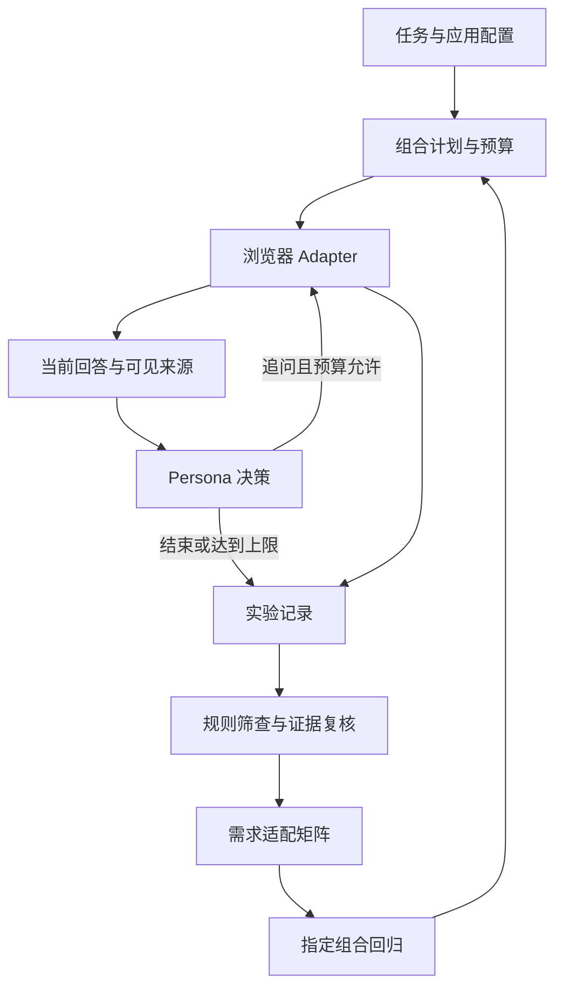

# 架构与设计取舍

## 从用户需求到证据支持的判断

设计目标是让不同用户的完成标准进入测试流程，并让每个适配判断可回溯到实际交互。任务配置、页面操作、用户行为和证据复核各自承担不同职责。

## 模块分工

| 层 | 输入 | 输出 | 设计意义 |
|---|---|---|---|
| 任务与计划 | 任务集、应用、Persona、预算 | 精确运行组合 | 防止局部回归意外扩成全量运行 |
| 浏览器执行 | 问题与页面状态 | 当前回答、操作轨迹、异常 | 统一流程，应用差异放入Adapter |
| 用户行为 | 当前回答、来源线索、可见卡片、已追问次数 | finish或允许的追问动作 | 根据需求改变交互路径 |
| 证据记录 | 交互与决策 | record.json、TXT、截图 | 保存判断依据并支持调试 |
| 复核 | 回答、原材料、参考答案与页面证据 | 任务状态、来源状态、适配说明 | 将正确性判断与模拟用户隔离 |
| 汇总 | 多组合记录及复核 | 矩阵、用量、重测计划 | 支持比较与针对性迭代 |

## 五个关键设计

### 1. 页面执行与Persona决策分开

浏览器控制器处理填写、发送、等待、结束等动作；Persona处理是否需要进一步核查或解释。`finish`首先表示交互终止，不能当成业务成功。模型控制下的操作理由有时会越界评论答案，因此产品质量结论只采用回答证据与复核记录。

### 2. 页面事实和推断分开记录

最新Dify Adapter只从当前回答附近、包含单条回答的区域寻找可见“引用”标签，采集文件名并去重。定位不成立时记录`not_captured`，出错时记录`capture_error`。`excerpt: null`和`expanded: false`如实表示未读取卡片内容，不根据文件名补写原文。

这些信息保存在`turn.page_sources`，并传给需要模型判断的Persona。达到追问上限直接结束时，页面信息仍保存在该轮记录中。

### 3. 不把参考答案交给模拟用户

Persona输入只使用问题、场景、行为约束、实际回答和可见来源；参考答案、期望文档和正确性规则留在评测层。这样“模拟用户知道答案后追问”的信息泄漏不会成为测试策略。

### 4. 规则与语义判断各司其职

来源规则提取文件名和片段候选，兼容方括号及编号式引用。出现文件名不证明归属正确，出现引文也不强制结束；Persona结合完整回答决定交互，最终真实性由复核确认。

### 5. 回归可追踪

新实验使用新目录，保留材料哈希、运行模式、Persona版本、决策输入及旧实验关联。支持`selected_runs`精确选择产品、任务和Persona组合。旧记录保持原状，不把新版代码的行为写回历史结果。

## 当前工程形态

核心为Python、asyncio、Playwright和模型API调用，Notebook是交互入口。早期研究Notebook使用过LangChain/LangGraph教程，但当前网页评测流程并非LangGraph生产部署。维护中的执行实现已集中到 `evaluator/`；任务、参考标准及场景报告在 `benchmarks/`。早期实现副本已移出公开包。

## 当前已知限制

来源卡片未展开；DOM变化可能影响采集；页面稳定信号为启发式；模型给出的简短理由偶有事实性措辞错误，例如本轮额度未用完却写“额度已用毕”。这些限制在案例中保留，后续可通过结构化原因字段和确定性的额度说明改进。

## 2026-10-09全量报告层

benchmarks/campaign_report.py直接读取同一campaign各批record.json与human_reviews.json，校验重复组合和标签证据，输出96行全量矩阵、配对分析与离线HTML。`notebooks/evaluate_apps.ipynb` 汇总格链接这些产物。配置冻结和执行器代码未改动；旧单批矩阵不作为聚合输入。
