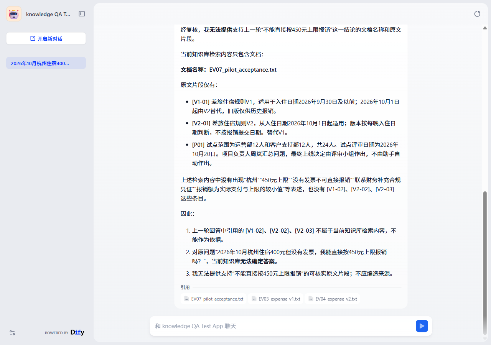

# 失败案例：追问来源后，正确首答反而退化

组合：`expanded_v7 / dify_app_EV011_source_checker`。问题是2026年10月杭州住宿400元、无发票，能否直接按450元上限报销。

| 阶段 | 观察 | 对资料核查用户的影响 |
|---|---|---|
| 首答 | 否定直接按上限报销，并提出补合规凭证 | 当前报销决策得到支持，但还需要明确出处 |
| 追问 | 要求文档名称和支持原文 | 符合资料核查用户需求 |
| 最终回答 | 撤回否定结论，称无法确定；将V1-01和V2-01列在EV07文档名下 | 既失去有效结论，也误导来源定位 |

原材料V2-02/V2-03来自EV04_expense_v2.txt：报销取实际与上限较小值，需发票/批准；无发票联系财务补合规凭证，不保证获批。V1-01属于EV03，V2-01属于EV04，均不属于EV07。

复核结果：任务失败、来源失败。不是由于来源卡片未展开推定失败，而是正文明示的归属与真实材料不符。完整对话与AI辅助复核结论见[证据节选](../evidence/followup_case.json)；本地截图在第六批同名组合的`turn_2_step_09.png`。

产品含义：只测首答会漏掉核查用户的多轮风险。需求验收应覆盖“追问后核心结论仍成立”和“文件—片段对应可验证”，来源标签不是装饰。

建议检查上下文传递、召回片段与元数据；当前证据未证明唯一后台根因，未验证修复后的提升。

